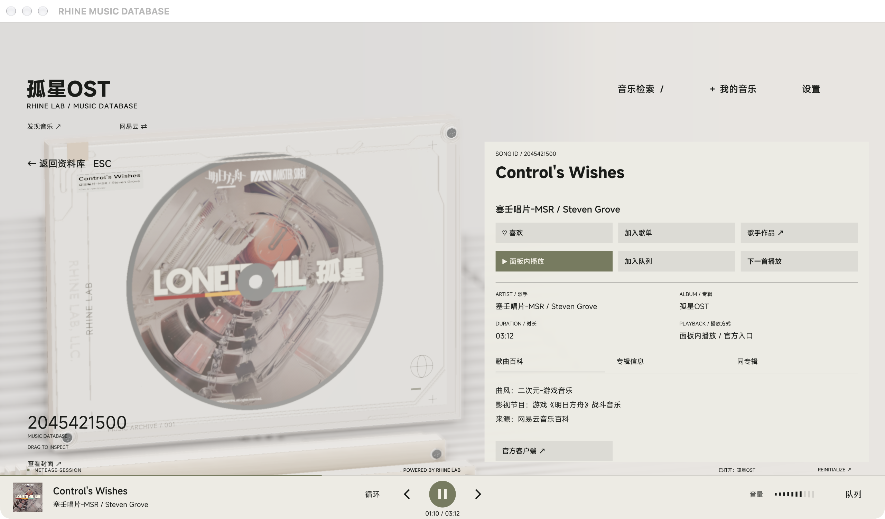
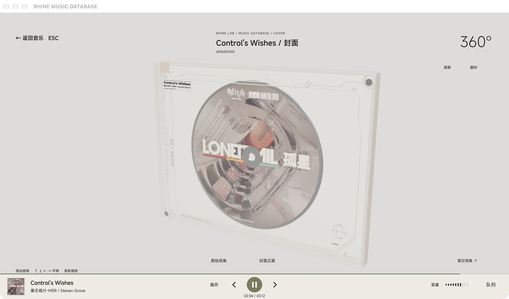

# RHINE MUSIC DATABASE

**基于莱茵生命终端的第三方网易云 / QQ 音乐面板**

这是对《明日方舟》特别映像「莱茵生命：访问」终端界面的非官方复刻

使用 **Qt 6 / QML / C++** 构建

面板支持检索、分组浏览、账号登录与 **播放**，同时保留网易云音乐官方客户端播放入口








## 快速运行

构建产物位于：

| 平台 | 程序 |
| --- | --- |
| macOS | `output/RHINE MUSIC DATABASE.app` |
| Windows | `output/windows/RHINE MUSIC DATABASE/RHINE MUSIC DATABASE.exe` |

**macOS 若提示应用已损坏，需要执行**

`xattr -r -d com.apple.quarantine '/Applications/RHINE MUSIC DATABASE.app'`

并且在设置-隐私中允许运行；

Windows 解压完整部署目录后启动 EXE，保留旁边的 Qt DLL、插件、QML 与资源目录。

**面板内播放支持网易云和 QQ 音乐返回的可用音源。网易云官方客户端入口需要安装并注册网易云音乐；QQ 提供来源网页入口。**

## 功能列表

勾选表示已实现；未勾选表示当前未实现，不代表承诺开发。

### 网易云音乐

- [x] 歌曲、专辑、歌单、歌手搜索与分页
- [x] 歌手热门歌曲与发行专辑
- [x] 扫码、手机密码、邮箱密码登录
- [x] 喜欢歌曲与收藏歌单、专辑、歌手
- [x] 创建、重命名、删除自己的歌单
- [x] 歌曲加入或移出歌单
- [x] 每日推荐、推荐歌单、排行榜、新专辑、分类歌单
- [x] 面板内播放与网易云官方客户端入口
- [ ] 歌词、MV、评论社交、云盘、电台
- [ ] 音乐下载

### QQ 音乐

- [x] 歌曲搜索（上游受限时使用搜索提示中的相关歌曲）
- [x] 从歌曲浏览专辑与歌手作品
- [x] 手机 QQ、微信扫码登录
- [x] 喜欢歌曲、自建及收藏歌单、收藏专辑
- [x] 自建非公开歌单读取
- [x] 首页推荐歌曲、榜单、新专辑、分类歌单
- [x] 面板内播放与来源网页入口
- [ ] 完整分页搜索与专辑、歌单、歌手独立搜索
- [ ] 账号内容编辑（喜欢、收藏及歌单管理）
- [ ] 歌词、MV、评论社交、电台
- [ ] 音乐下载

### 面板本身

- [x] 三维光盘盒、唱片与资料库动画
- [x] 原生全屏与窗口模式切换
- [x] 按歌手或专辑分组浏览已载入结果
- [x] 网易云 / QQ 来源切换与账号、请求、缓存隔离
- [x] 播放、暂停、切歌、进度与音量控制
- [x] 播放队列、删除待播曲目、循环与随机播放
- [x] 搜索历史、播放历史与本机偏好保存
- [x] 亮色、暗色、跟随系统与减少动效
- [x] 音质选择、试听提示与可选替代音源
- [x] macOS 系统媒体按钮
- [x] macOS Apple Silicon 与 Windows x64 构建和打包
- [ ] 歌词显示与 MV 播放

**音质和完整播放取决于账号权限与音源可用性；返回试听时会明确提示。替代音源默认关闭，开启时使用锁定上游的匹配实现，音质由匹配来源决定，失败时可使用官方入口。本项目不提供音乐下载。**

## 从源码构建

需要包含 Shader Tools 和 Multimedia 的 Qt **6.8+** desktop kit、CMake 3.24+、Ninja、Python 3、Node.js / npm，以及平台 C++ 编译器。建议两端固定相同 Qt 补丁版本；自动构建使用 Qt 6.8.3 与 Node.js 22.14.0。

`QT_ROOT` 指向 Qt kit 根目录。`RHINE_NODE_BINARY` 和 `RHINE_NODE_LICENSE` 指向官方独立 Node 分发包中的可执行文件与对应许可证；该运行时会随应用打包，不提交到源码仓库。

### macOS

安装 Xcode Command Line Tools 和匹配处理器的 Qt kit，在项目目录执行：

```sh
export QT_ROOT="$HOME/Qt/6.8.3/macos"
export RHINE_NODE_BINARY="/absolute/path/to/node/bin/node"
export RHINE_NODE_LICENSE="/absolute/path/to/node/LICENSE"
npm ci
npm run build
npm test
npm run share
```

本机已有 `vendor/node-arm64/node` 与许可证时可作为默认运行时。`QT_ROOT` 未设置时使用 `~/Qt/6.12.0/macos`。

### Windows x64

安装 Visual Studio 2022 的“使用 C++ 的桌面开发”组件、Windows SDK 和 Qt MSVC 2022 64 位 kit。在 **Developer PowerShell for VS 2022** 中进入项目目录：

```powershell
$env:QT_ROOT = 'C:\Qt\6.8.3\msvc2022_64'
$env:RHINE_NODE_BINARY = 'C:\tools\node-v22.14.0-win-x64\node.exe'
$env:RHINE_NODE_LICENSE = 'C:\tools\node-v22.14.0-win-x64\LICENSE'
npm ci
npm run build
npm test
npm run share
```

`npm run share` 将完整部署目录打包为 ZIP。运行时不需要开发工具、Python 或额外安装 Node；不能只分发 EXE。

### 开发与测试

默认构建类型为 `Release`。设置 `RHINE_BUILD_TYPE=Debug` 可构建调试版本；`PYTHON` 可覆盖 Python 命令。Qt 6.12+ 安装包含官方 QML Live Preview 工具时，可使用 `npm run preview` 进行热预览。

`npm test` 使用本地响应验证场景、拾取、音乐状态、账号隔离、锁定上游、打包通信和部署资源。设置 `RHINE_GPU_TEST=1` 可额外执行真实 GPU 离线渲染检查；Windows 设置 `RHINE_SOFTWARE_GPU=1` 可使用软件 GPU。离线测试不替代真实账号、在线音源、显示缩放与系统集成的实机检查。

Qt RHI 使用私有头文件，升级 Qt 后需重新编译并验证。

## 本机数据与隐私

搜索、歌曲资料、扫码与个人音乐库请求发送至所选音乐平台，封面从网易云或 QQ 音乐域名加载。原始认证记录仅由 C++ 和 Node 桥处理，并通过系统凭据库加密保存。本项目没有自建的数据收集服务器、分析 SDK 或自动上传诊断功能。

登录为可选功能。应用不读取浏览器或官方客户端的登录信息。

## 参考项目

- **[NeteaseCloudMusicApiEnhanced](https://github.com/NeteaseCloudMusicApiEnhanced/api-enhanced)**: 网易云接入
- **[yakult-green-tea/qq-music-api](https://github.com/yakult-green-tea/qq-music-api)**: QQ 音乐接入
- **[LBEILC / RhineLabUI](https://github.com/LBEILC/RhineLabUI)**：特别感谢原界面、模型与场景作者，版权声明随项目保留。

## 开源许可

本项目保留 [MIT License](LICENSE) 与原作者版权声明。第三方字体、Qt 和依赖分别遵循各自许可证；相关许可随部署包保留。

《明日方舟》、莱茵生命及其名称、标志与原作视觉设计的相关权利归各自权利人所有。本项目为非官方衍生作品，项目的 MIT 许可不代替第三方内容的授权。
