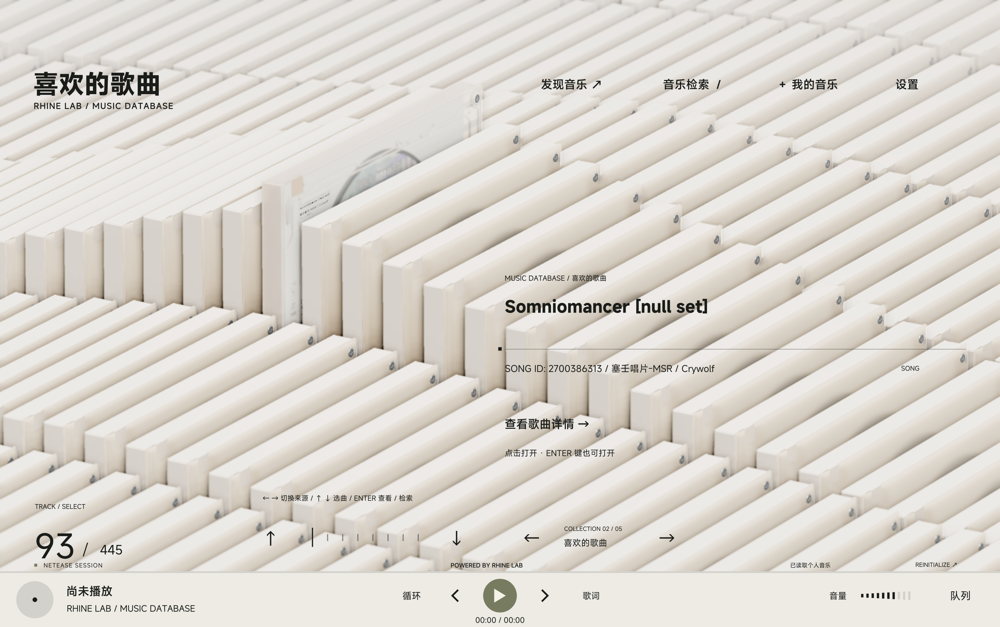
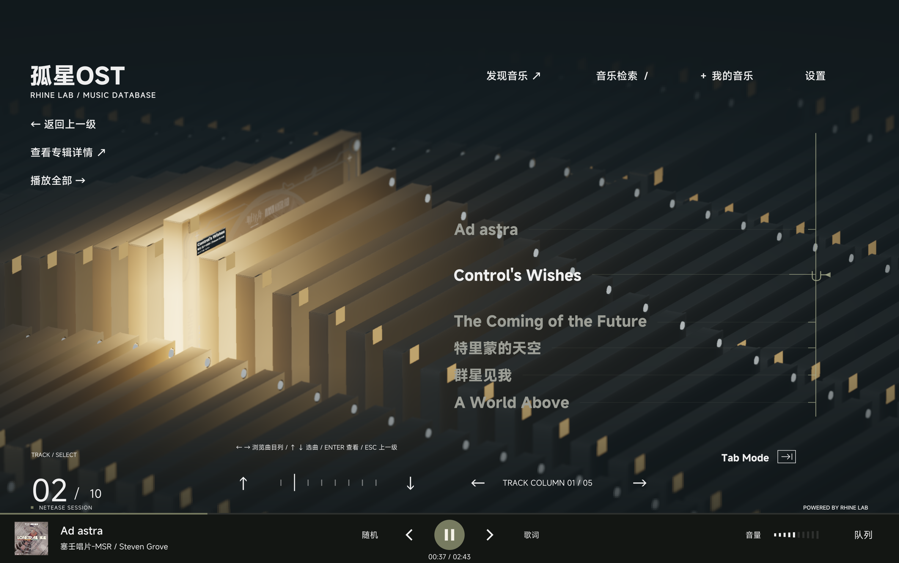
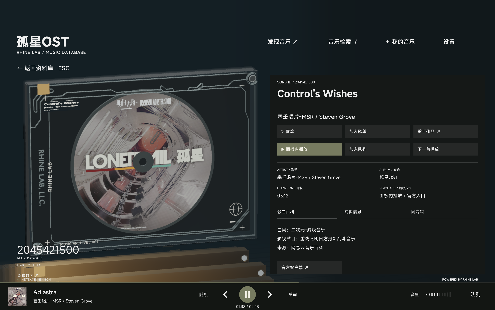
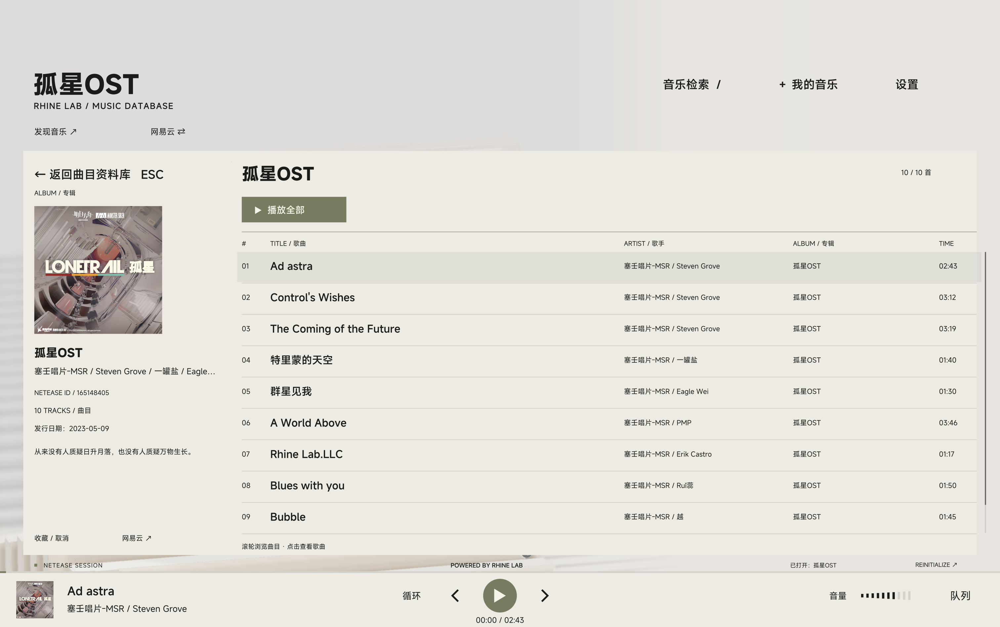
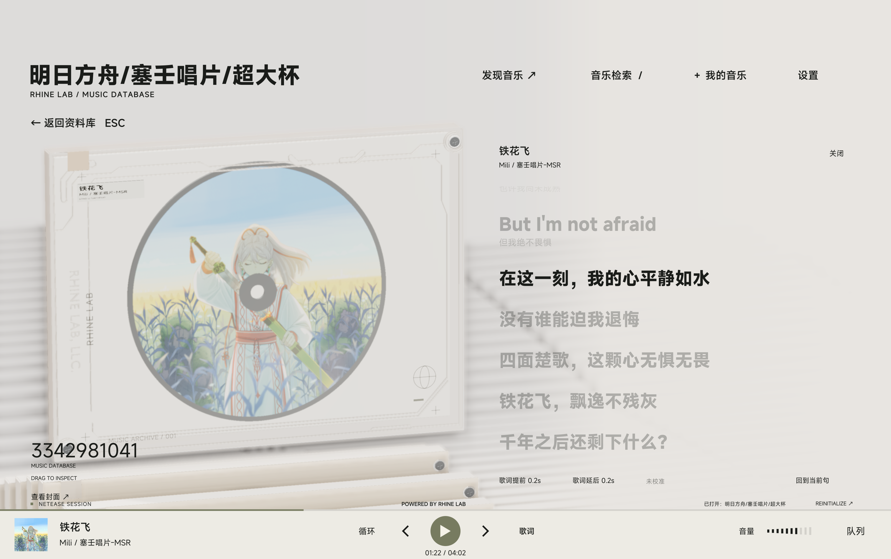
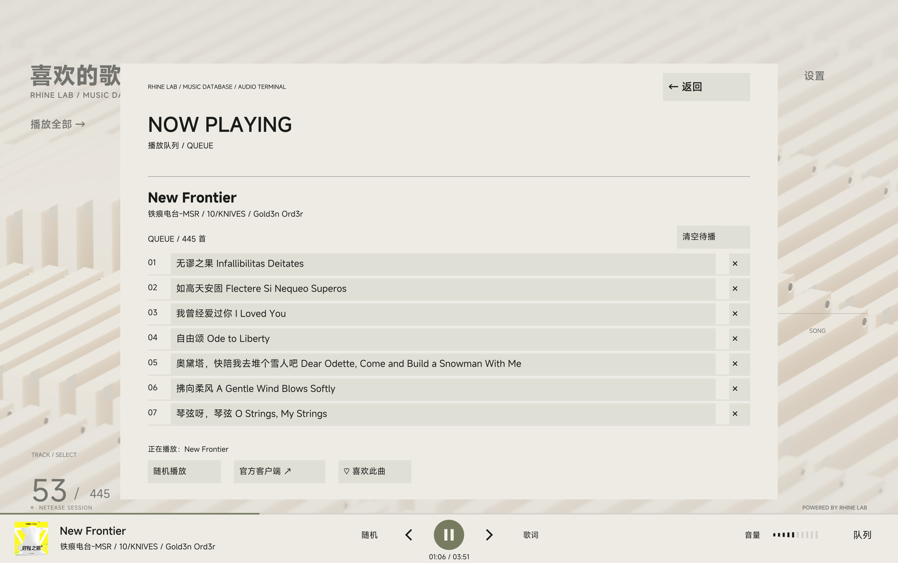
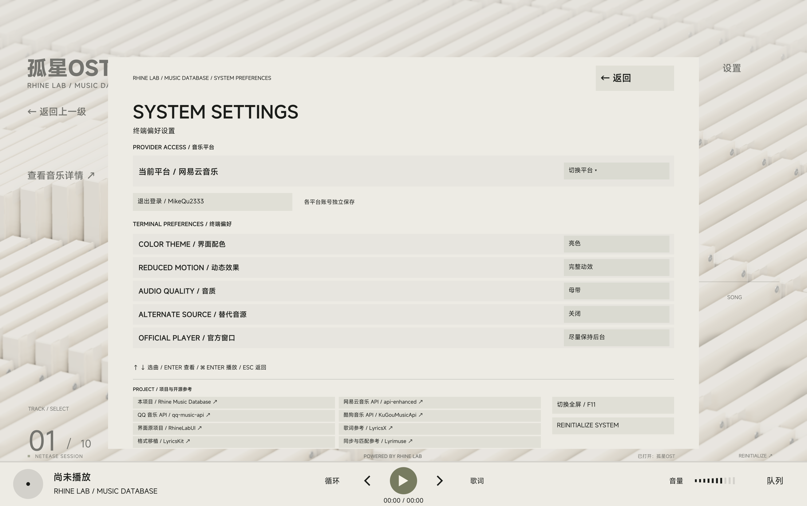

# RHINE MUSIC DATABASE

**基于莱茵生命终端的第三方网易云 / QQ / 酷狗音乐面板**

这是对《明日方舟》特别映像「莱茵生命：访问」终端界面的非官方复刻

使用 **Qt 6 / QML / C++** 构建

面板支持检索、分组浏览、账号登录与 **播放**，同时保留网易云音乐官方客户端播放入口















## 快速运行

构建产物位于：

| 平台    | 程序                                                         |
| ------- | ------------------------------------------------------------ |
| macOS   | `output/RHINE MUSIC DATABASE.app`                            |
| Windows | `output/RhineMusicDatabase-<构建标识>-Windows-x64-Setup.exe` |
| Linux   | `output/RhineMusicDatabase-<构建标识>-Linux-x86_64.AppImage` |

**macOS 若提示应用已损坏，需要执行**

`xattr -r -d com.apple.quarantine '/Applications/RHINE MUSIC DATABASE.app'`

并且在设置-隐私中允许运行；

Windows 运行 `RhineMusicDatabase-<构建标识>-Windows-x64-Setup.exe` 安装程序。
Qt、MSVC 运行库和 Node 桥接均已随包提供，无需另行安装。

Linux 赋予执行权限后直接运行 AppImage，Qt 运行时、QML 模块、FFmpeg 与 Node 桥接都已随包提供：

```sh
chmod +x 'RhineMusicDatabase-<构建标识>-Linux-x86_64.AppImage'
./'RhineMusicDatabase-<构建标识>-Linux-x86_64.AppImage'
```

没有 FUSE 的环境（容器、部分滚动发行版）加上 `--appimage-extract-and-run` 参数同样可以启动。

macOS、Linux 和 Windows 默认使用 FFmpeg 音频后端。Windows 设置 `QT_MEDIA_BACKEND=windows` 可临时对照原生后端。
各平台播放都会跟随系统默认输出设备

桌面播放默认由独立后台服务管理（设置 → 性能与诊断 → 性能模式，默认开启，重启生效）。关闭到菜单栏、
最小化或被其他应用遮挡时，受控呈现层会卸载界面引擎并改为预渲染的静态欢迎帧，音频、队列和系统媒体键
继续由后台服务工作；恢复时在同一窗口重建界面，不会重建窗口、音频源或切换桌面。关闭或未启用性能模式时
仍为单进程路径。

图形后端在 Windows 与 Linux 上优先使用 Vulkan，不可用时回退 OpenGL；macOS 固定使用 Metal。
`RHINE_GRAPHICS=vulkan|opengl|auto` 可手动指定，`QSG_RHI_BACKEND` 的优先级更高。

Linux 的「设置 → GPU / 显卡」可以指定用哪一块显卡，重启生效。列表只显示序号（0 基，与 `/sys/class/drm` 的 `cardN` 顺序一致），保存的也是序号——型号会随驱动更新和换卡变化，序号才是稳定的东西。序号在下次启动时不存在（换卡、拔掉 eGPU 或配置被改坏）就自动回退到默认行为：不注入任何厂商变量，完全等同于此前的版本，设置页会注明「序号 N 不存在」。
实现上按驱动分流：Mesa 系（i915 / xe / amdgpu / nouveau）用 `DRI_PRIME=pci-0000_01_00_0` 把目标卡排到物理设备列表首位，NVIDIA 专有驱动用 `__NV_PRIME_RENDER_OFFLOAD=1` 加 `__VK_LAYER_NV_optimus=NVIDIA_only`（选非 NVIDIA 卡时为 `non_NVIDIA_only`），Qt 取枚举到的第一块卡即等于选中。`RHINE_GPU_INDEX=N` 只对本次启动生效，不改配置，便于对照；`RHINE_SOFTWARE_GPU=1` 时不做任何选择。两张同型号 NVIDIA 显卡之间无法区分（NVIDIA 图层只能表达「要 / 不要 NVIDIA」），此时会打一条警告。

**面板内播放支持网易云、QQ 和酷狗音乐返回的可用音源。网易云官方客户端入口需要安装并注册网易云音乐；QQ 提供来源网页入口，酷狗提供官方网站入口。**

## 功能列表

勾选表示已实现；未勾选表示当前未实现，不代表承诺开发。

### 网易云音乐

- [x] 歌曲、专辑、歌单、歌手搜索与分页
- [x] 歌手热门歌曲与发行专辑
- [x] 扫码、手机短信验证码登录
- [x] 喜欢歌曲与收藏歌单、专辑、歌手
- [x] 创建、重命名、删除自己的歌单
- [x] 歌曲加入或移出歌单
- [x] 每日推荐、推荐歌单、排行榜、新专辑、分类歌单
- [x] 面板内播放与网易云官方客户端入口
- [x] 同步歌词与逐句滚动
- [ ] MV、评论社交、云盘、电台
- [ ] 音乐下载

### QQ 音乐

- [x] 关键字搜索
- [x] 从歌曲浏览专辑与歌手作品
- [x] 手机 QQ、微信扫码登录
- [x] 喜欢歌曲、自建及收藏歌单、收藏专辑
- [x] 自建非公开歌单读取
- [x] 每日 30 首、猜你喜欢、推荐歌单、榜单、新专辑、分类歌单、新歌速递
- [x] 面板内播放与来源网页入口
- [x] 歌曲、专辑、歌单、歌手独立搜索与分页
- [x] 红心与取消红心，收藏及取消收藏歌单、专辑
- [x] 创建、改名、删除本人普通歌单，普通曲库歌曲加歌、移除
- [x] 同步歌词与逐句滚动
- [ ] MV、评论社交、电台
- [ ] 音乐下载

### 酷狗音乐（标准版 / 概念版）

- [x] 选择标准版或概念版 App 扫码登录，固定设备身份与两个版本独立的本机加密凭据保存
- [x] 登录后的歌曲、专辑、歌单、歌手搜索
- [x] 自建及收藏歌单、默认喜欢歌单读取，歌单、榜单及专辑曲目播放
- [x] 推荐歌单、每日推荐、排行榜、新专辑与分类歌单
- [x] 歌手单曲和发行专辑浏览
- [x] 按文档注册设备取得 dfid，再调用 `/song/url`；高音质不可用时回退标准音质
- [ ] 收藏专辑读取与账号内容编辑
- [x] 同步歌词与逐句滚动
- [ ] MV、评论社交、云盘、电台、下载

### 本地音乐

- [x] 导入文件或递归导入文件夹并建立索引，支持 MP3、FLAC、M4A、MP4、AAC、OGG、Opus、APE、WAV、AIFF、WV、WMA、MPC
- [x] 读取标题、歌手、专辑、年份、时长、采样率与码率；无标签时从“歌手 - 歌名”文件名推断检索词
- [x] 同目录 `cover`、`folder` 或 `front` 图片优先，其次读取内嵌封面，封面缓存到应用数据目录
- [x] 同名 `.lrc` 歌词优先，其次内嵌歌词；本地歌词来源可选自动、本地或指定平台
- [x] 缺少歌词或封面时复用跨平台录音匹配补充，不改写音频标签或音乐文件
- [x] 按歌曲、歌手、专辑与文件夹分组浏览，支持本地检索
- [x] 面板内播放、播放队列与同步歌词
- [x] 按文件名、编码格式、采样率与码率近似匹配网易云音质标识
- [x] `.rhineignore` 或 `.foliaignore` 排除规则，支持 `*`、`?`、`**`、目录末尾 `/`、根路径前导 `/` 与 `!` 否定
- [x] 重新扫描、取消扫描；移除导入位置只删除索引，不删除磁盘文件
- [x] 离线时已导入的曲目、封面与本地歌词仍可播放

### 面板本身

- [x] 三维光盘盒、唱片与资料库动画
- [x] 原生全屏与窗口模式切换
- [x] 按歌手或专辑分组浏览已载入结果
- [x] 网易云 / QQ / 酷狗直接选择与账号、请求、缓存隔离
- [x] 播放、暂停、切歌、进度与音量控制
- [x] 播放栏歌词入口、当前歌曲歌词页面、点击歌词跳转、单曲时间校准与离线歌词缓存

- [x] 播放队列、删除待播曲目、循环与随机播放
- [x] 搜索历史、播放历史与本机偏好保存
- [x] 亮色、暗色、跟随系统与减少动效
- [x] 音质选择、试听提示与可选替代音源
- [x] macOS 系统媒体按钮
- [x] macOS Apple Silicon、Linux x86_64 与 Windows x64 构建和打包
- [ ] MV 播放

**音质和完整播放取决于账号权限与音源可用性；返回试听时会明确提示。替代音源默认关闭，开启时使用锁定上游的匹配实现，音质由匹配来源决定，失败时可使用官方入口。本项目不提供音乐下载。**

## 图形后端与功能

| Platform | Vulkan | Direct3D 12 | OpenGL | Metal |
| -------- | ------ | ----------- | ------ | ----- |
| Windows  | ✅     | 已停用      | ✅     | -     |
| macOS    | -      | -           | -      | ✅    |
| Linux    | ✅     | -           | ✅     | -     |

| API         | FXAA   | SSAA   | MSAA   | TAA     | Upscaling        | Frame Generation |
| ----------- | ------ | ------ | ------ | ------- | ---------------- | ---------------- |
| Vulkan      | ✅     | 2x MAX | 8x MAX | ✅      | EASU + RCAS      | ✅               |
| Direct3D 12 | 已停用 | -      | -      | -       | -                | -                |
| OpenGL      | ✅     | 2x MAX | 8x MAX | ✅      | EASU + RCAS      | -                |
| Metal       | -      | -      | -      | MetalFX | MetalFX Temporal | MetalFX          |

插帧（FSR Frame Generation）在 Vulkan 上是**常驻能力、即时开关**：只要设备支持，启动时应用就自建
交换链接管窗口（呈现层常驻），设置页里的帧生成开关**点一下就生效、不需要重启**——它只决定每次呈现
要不要插入一张插值帧，不参与呈现路径的选择。只有 3D 场景参与插值，UI 始终以原生分辨率叠加在插值结果
之上（插值帧里文字不会重影）。任何一步失败都会自动回退到默认呈现路径，不影响启动；需要强制走默认
路径时可用 `RHINE_FG_LAYER=off`（排障用）。标题栏右上角的性能面板在接管后会显示帧生成状态、呈现与
渲染帧率、插值帧率、光流/插值/合成/取图/上屏分项耗时、交换链图像数与格式、深度与运动矢量是否就绪。

## 从源码构建

需要包含 Shader Tools 和 Multimedia 的 Qt **6.12+** desktop kit、CMake 3.24+、Ninja、Python 3、Node.js / npm，以及平台 C++ 编译器。本地与三平台自动构建统一使用 Qt 6.12.0，自动构建使用 Node.js 26.11.1。Linux 还需要 Qt 的私有开发头文件（发行版包名通常是 `qt6-base-private-dev`、`qt6-multimedia-private-dev`）。

`QT_ROOT` 指向 Qt kit 根目录。`RHINE_NODE_BINARY` 和 `RHINE_NODE_LICENSE` 指向官方独立 Node 分发包中的可执行文件与对应许可证；该运行时会随应用打包，不提交到源码仓库。

FSR3 超分与插帧依赖 `FidelityFX-SDK/`，着色器预编译依赖 `third_party/dxc` 与 `third_party/glslang`，三者都以 submodule 记录，克隆时需要递归检出：

```sh
git clone --recurse-submodules <仓库地址>
# 已克隆的仓库补检出
git submodule update --init --recursive
```

`FidelityFX-SDK/` 缺失时 CMake 只打印一条状态信息并跳过 FSR 目标，构建仍然成功但 FSR3 不会编入；`third_party/glslang` 缺失时回退到系统 `glslangValidator`；`third_party/dxc` 缺失在 Windows 上会直接报错。`spirv-tools` 与 `spirv-headers` 无法嵌套为 submodule，版本记录在 `.gitmodules` 的 `pinned-commit` 中。

### macOS

安装 Xcode Command Line Tools 和匹配处理器的 Qt kit，在项目目录执行：

```sh
export QT_ROOT="$HOME/Qt/6.12.0/macos"
export RHINE_NODE_BINARY="/absolute/path/to/node/bin/node"
export RHINE_NODE_LICENSE="/absolute/path/to/node/LICENSE"
npm ci
npm run build
npm test
npm run share
```

本机已有 `vendor/node-arm64/node` 与许可证时可作为默认运行时。`QT_ROOT` 未设置时使用 `~/Qt/6.12.0/macos`。

### Windows x64

安装 Visual Studio 2022 的“使用 C++ 的桌面开发”组件、Windows SDK 和 Qt MSVC 2022 64 位 kit。在 **Developer PowerShell for VS 2022** 中进入项目目录：

```powershell
$env:QT_ROOT = 'C:\Qt\6.12.0\msvc2022_64'
$env:RHINE_NODE_BINARY = 'C:\tools\node-v22.14.0-win-x64\node.exe'
$env:RHINE_NODE_LICENSE = 'C:\tools\node-v22.14.0-win-x64\LICENSE'
npm ci
npm run build
npm test
npm run share
```

Windows 的 `npm run share` 使用 [Inno Setup 6.3+ 或 7](https://jrsoftware.org/isdl.php)，
只生成 `output/RhineMusicDatabase-<构建标识>-Windows-x64-Setup.exe` 安装程序。
安装器默认安装到 `%LOCALAPPDATA%\Programs\RhineMusicDatabase`，无需管理员权限，提供开始菜单快捷方式、可选桌面快捷方式和卸载入口。
应用在安装目录的 `data` 中保存账号、设置和缓存，请选择当前用户可写的目录。安装包排除构建机上的运行数据，覆盖安装和卸载保留用户的 `data`；彻底清理时可手动删除。

### Linux x86_64（AppImage）

安装 Qt 6.12.0 开发包（含 Shader Tools、Multimedia 与私有头文件）、CMake、Ninja、GCC、Python 3 和 Node.js 26.11.1；若发行版尚未提供此版本，使用官方 desktop kit 并设置 `QT_ROOT`。Qt 由系统提供时 `QT_ROOT` 保持默认的 `/usr` 即可：

```sh
curl -LO https://nodejs.org/dist/v26.11.1/node-v26.11.1-linux-x64.tar.xz
mkdir -p output/node
tar -xJf node-v26.11.1-linux-x64.tar.xz -C output/node
# rm ./node-v26.11.1-linux-x64.tar.xz
npm ci
env RHINE_NODE_BINARY=$PWD/output/node/node-v26.11.1-linux-x64/bin/node \
    RHINE_NODE_LICENSE=$PWD/output/node/node-v26.11.1-linux-x64/LICENSE \
    NPM_CONFIG_ALLOW_REMOTE=all npm run build

# 增量构建测试
cmake --build output/qt-build -j 8
RHINE_RESOURCES=$PWD/output/resources ./output/qt-build/RhineMusicDatabase 2>&1

# 关闭抗锯齿和超分辨率启动
RHINE_RESOURCES=$PWD/output/resources RHINE_AA_MODE=off ./output/qt-build/RhineMusicDatabase
```

`npm run build` 先按依赖闭包收集 Qt 库、平台插件、图像与 TLS 插件和 QML 模块到 `output/RhineMusicDatabase.AppDir`，再用 `appimagetool` 生成 `output/RhineMusicDatabase-<构建标识>-Linux-x86_64.AppImage`。`appimagetool` 需自行安装并出现在 `PATH` 中，也可用 `APPIMAGE_TOOL` 指定路径；没有 FUSE 时脚本自动改用 `--appimage-extract-and-run`。

随包的 Node 必须是官方独立分发包：构建脚本会检查 `ldd` 结果，只依赖 glibc 运行库的构建才会被打进 AppImage，发行版自己的 `/usr/bin/node` 动态链接了系统 ICU 等库，会被拒绝。

### 开发与测试

默认构建类型为 `Release`。设置 `RHINE_BUILD_TYPE=Debug` 可构建调试版本；`PYTHON` 可覆盖 Python 命令。Qt 6.12+ 安装包含官方 QML Live Preview 工具时，可使用 `npm run preview` 进行热预览。

设置 `RHINE_VERSION=vX.Y.Z` 时构建正式版，分发包的构建标识为 `vX.Y.Z`。
未指定版本时为开发版：设置中显示最后一次提交标题、12 位短 SHA 和“开发版”，三平台分发包均以短 SHA 作为构建标识。
检查更新仅获取发布信息；点击“前往更新”会打开 [GitHub releases 页面](https://github.com/MikeQu223/Rhine-Music-Database/releases)，由浏览器下载，不在应用内下载文件。

`npm test` 使用本地响应验证音乐与播放状态、账号隔离、输入法焦点与提交、窗口迁移、锁定上游、打包通信和部署资源。默认测试不包含视觉快照、固定动画采样或桌面场景组合。离线测试不替代真实账号、在线音源、显示缩放、系统输入法与系统集成的实机检查。

Qt RHI 使用私有头文件，升级 Qt 后需重新编译并验证。

## iOS / iPadOS 构建

需要 macOS、完整 Xcode、Qt 6.12.0 的 `ios_device` kit，以及已安装的桌面构建依赖。
执行 `npm run build:ios`，生成 `output/RhineMusicDatabase-ios-unsigned.ipa`；该文件需自行签名后安装。
`RHINE_IOS_QT` 可以指定其他同版本 kit 路径。构建自动校验 NodeMobile 下载哈希，并检查包内架构、资源和动态依赖。

## 本机数据与隐私

搜索、歌曲资料、扫码与个人音乐库请求发送至所选音乐平台，封面从网易云、QQ 或酷狗音乐的图片域名加载。原始认证记录仅由 C++ 和 Node 桥处理；macOS 保存在钥匙串，Windows 通过 DPAPI 加密，Linux 保存在 `~/.local/share/RhineMusicDatabase/rhine.music.database/account.credential`（权限 `0600`）。本项目没有自建的数据收集服务器、分析 SDK 或自动上传诊断功能。

登录为可选功能。应用不读取浏览器或官方客户端的登录信息。

## 性能面板与诊断

在「设置」中向下滚动至「性能与诊断」，点击「显示 / 隐藏 · F10」，即可打开性能面板；
也可以按 F10（部分笔记本需 Fn+F10）。设置内容支持滚轮、触控板、上下方向键与侧边箭头滚动，
原有菜单尺寸和间距保持不变。性能面板支持精简与展开。
面板显示实际 Qt 呈现帧率、场景提交帧率、帧间隔 P50/P95/P99 与峰值、逻辑/同步/提交 CPU 耗时、
主进程常驻内存及渲染资源。程序采用按需绘制，静止时低帧率和较长帧间隔属于正常休眠；
Qt 帧率包含面板刷新。CPU 百分比以单个逻辑核心为 100%，内存和 CPU 不包含 Node 音乐桥接子进程。
GPU 耗时/占用未采集，同步和提交的 CPU 时间不代表 GPU 执行时间。

点击「开始收集」，复现卡顿后点击「停止并导出」，会在系统文稿目录下的 `RHINE Diagnostics`
生成 JSON 诊断文件；点击「诊断目录」可打开所在文件夹。每半秒汇总一次，另保留最多 36,000 帧的逐帧呈现/CPU 计时（超出数量在文件中注明），
最长十分钟自动导出，
退出程序时也会保存进行中的录制。导出失败可重试。文件只包含性能数值和系统/图形后端信息，
不包含账号、Cookie、搜索词、曲目、请求内容或截图。关闭面板且未录制时停止性能采样。

## 参考项目

- **[NeteaseCloudMusicApiEnhanced](https://github.com/NeteaseCloudMusicApiEnhanced/api-enhanced)**: 网易云接入
- **[MakcRe/KuGouMusicApi](https://github.com/MakcRe/KuGouMusicApi)**: 酷狗音乐标准版及概念版接入
- **[yakult-green-tea/qq-music-api](https://github.com/yakult-green-tea/qq-music-api)**: QQ 音乐接入
- **[LBEILC / RhineLabUI](https://github.com/LBEILC/RhineLabUI)**：特别感谢原界面、模型与场景作者，版权声明随项目保留。
- **[LyricsX](https://github.com/MxIris-LyricsX-Project/LyricsX)**：歌词获取、解析与显示分层参考。
- **[LyricsKit](https://github.com/MxIris-LyricsX-Project/LyricsKit)**：LRC、YRC、KRC 格式解析移植，
  `MusicBridge/lyrics-format.cjs` 单独采用 MPL-2.0，固定版本与许可随包保留。
- **[Lyrimuse](https://github.com/Yudaotor/lyrimuse)**：统一时间轴、歌词同步与录音版本匹配思路参考。

## 开源许可

本项目保留 [MIT License](LICENSE) 与原作者版权声明。第三方字体、Qt 和依赖分别遵循各自许可证；相关许可随部署包保留。

《明日方舟》、莱茵生命及其名称、标志与原作视觉设计的相关权利归各自权利人所有。本项目为非官方衍生作品，项目的 MIT 许可不代替第三方内容的授权。
